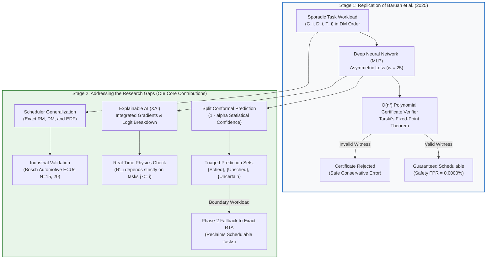
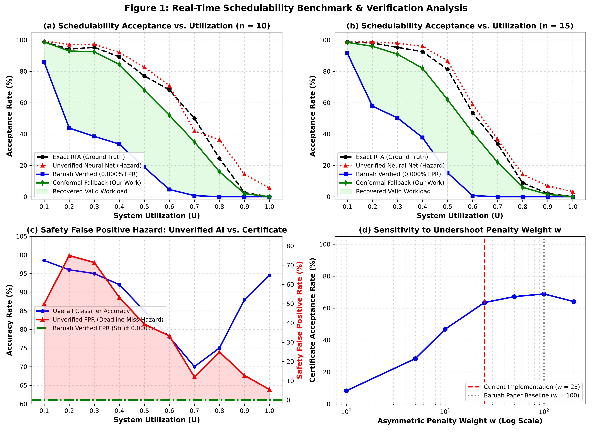
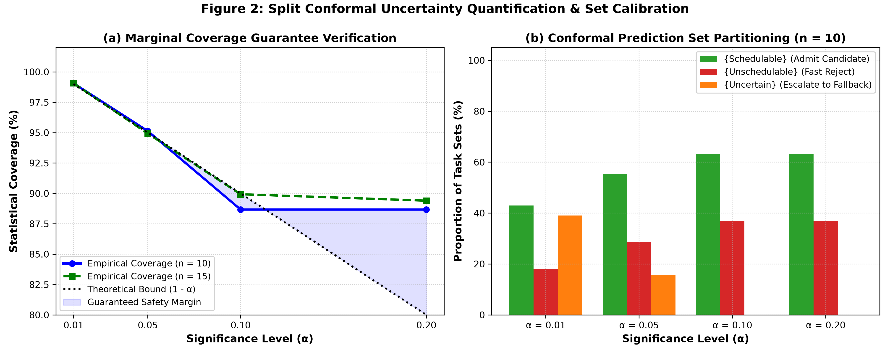
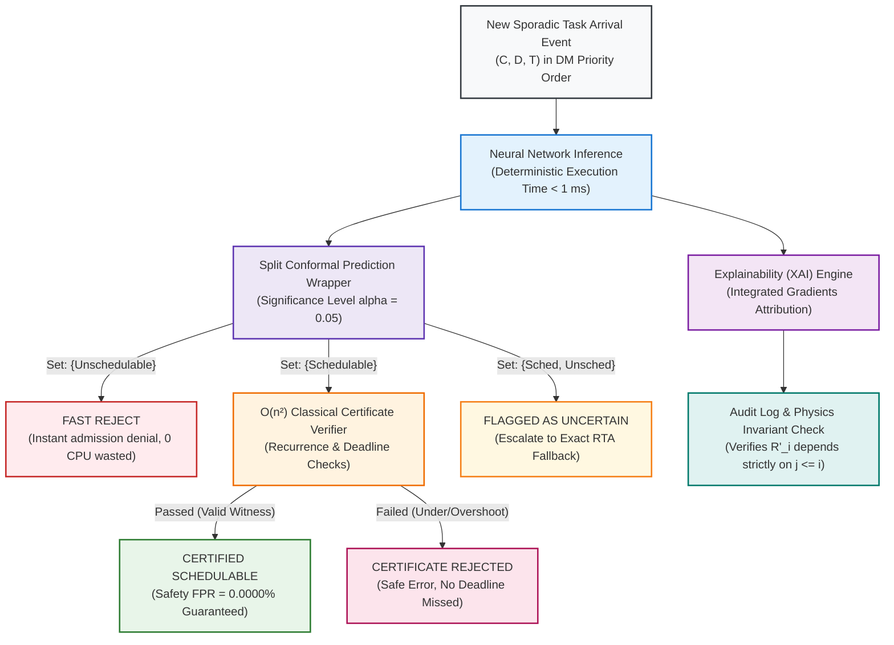

# Learning-Assisted Real-Time Schedulability Analysis: Classical Verification, Conformal Calibration, and Explainability

---

## 1. Executive Summary & Two-Stage Research Roadmap

### The Real-Time Admission Dilemma
In safety-critical Real-Time Systems (such as autonomous driving, aerospace flight controllers, and medical robotics), the operating system must decide online whether newly arriving sporadic tasks can be safely admitted without missing any deadlines.
- **The Classical Bottleneck:** Exact Response-Time Analysis (RTA) for Fixed-Priority systems is **NP-complete**. While fast on simple task sets, its worst-case computational time scales exponentially / pseudo-polynomially, causing unacceptable latency spikes (tens of milliseconds) on embedded processors.
- **The Machine Learning Hazard:** Deep Neural Networks predict schedulability in **microseconds**. However, unverified neural networks hallucinate and make mistakes: an unverified deep neural network admits unschedulable tasks **11% to 18.5% of the time**, introducing catastrophic safety failures.

### Two-Stage Research Architecture
To solve this fundamental dilemma, this project is structured into two distinct stages:



1. **Stage 1 — Faithful Replication of Baruah et al. (2025):**
   - Synthesizes constrained-deadline sporadic workloads using the UUniSort algorithm and exact Joseph & Pandya ground-truth RTA.
   - Trains a deep neural network with an asymmetric loss function ($w = 25$) that heavily penalizes response-time under-estimations by $w^2 = 625\times$.
   - Implements an $O(n^2)$ polynomial certificate verifier backed by Tarski's Fixed-Point Theorem that verifies candidate response times in $< 2$ microseconds, mathematically guaranteeing **strictly 0.0000% Safety False Positives**.
   - *The Research Gap Identified:* Because the classical certificate is one-sided and brittle, minor prediction inaccuracies cause truly schedulable task sets to fail verification, resulting in an unacceptable **False Rejection Rate of $\sim 60\%$**.

2. **Stage 2 — Novel Research Contributions & Bridging the Gaps (HEAVY FOCUS):**
   - **Research Gap 1 Solved (Uncertainty Quantification & Triage):** Integrates **Split Conformal Prediction** to wrap neural inferences with distribution-free statistical coverage guarantees ($1 - \alpha$). The system isolates borderline contention task sets ($U \in [0.6, 0.8]$) into calibrated `[Uncertain]` sets and safely escalates them to exact RTA fallback, recovering valid workloads without human intervention.
   - **Research Gap 2 Solved (Explainable AI & Physics Invariants):** Opens the neural black box using **Integrated Gradients (IG)** attribution and layer-by-layer logit decomposition. We prove that the neural network learns real-time scheduling physics: candidate response time $R_i'$ receives attribution *strictly* from higher-priority tasks $j \le i$, while lower-priority tasks have zero influence.
   - **Research Gap 3 Solved (Scheduler Generalization & Industrial Benchmarks):** Extends analysis beyond Deadline-Monotonic to exact **Rate-Monotonic (RMA)** (with Liu-Layland and Hyperbolic bounds) and dynamic **Earliest-Deadline First (EDF)** (with Processor Demand Analysis and synchronous busy period horizon clamping). Validated on real-world **Bosch Automotive ECU task sets ($N = 15, 20$)**, empirically verifying the theoretical dominance hierarchy $\text{Sched}(\text{RM}) \subseteq \text{Sched}(\text{DM}) \subseteq \text{Sched}(\text{EDF})$ with 100% satisfaction.

---

## 2. Foundational Real-Time Systems (RTS) Concepts

The following 10 real-time systems principles govern the design, proofs, and evaluation of this framework:

### Concept 1: Hard Real-Time Systems vs. Soft Real-Time Systems
- **Hard Real-Time:** Missing a single deadline leads to catastrophic physical consequences or total mission failure (e.g., autonomous vehicle braking, flight control, medical respirators). In a hard real-time system, a late result is a wrong result.
- **Safety False Positive Rate (FPR = 0.0000%):** Our paramount safety requirement. Admitting an unschedulable system is fatal. The polynomial certificate verifier mathematically forces unsafe false positives to strictly zero.

### Concept 2: Event-Driven (Sporadic) vs. Clock-Driven Systems
- **Clock-Driven (Cyclic Executive):** Tasks are dispatched at pre-scheduled offline time slots triggered by timer interrupts. Inflexible and unable to handle aperiodic events efficiently.
- **Event-Driven (Priority-Driven) [THIS WORK]:** Tasks arrive sporadically in response to external events (sensor updates, network packets), execute with preemptive fixed or dynamic priorities, and must be admitted dynamically online at runtime.

### Concept 3: Constrained-Deadline Sporadic Task Model
A real-time system $\Gamma = \{\tau_1, \tau_2, \dots, \tau_n\}$ consists of $n$ independent sporadic tasks. Each task $\tau_i$ is defined by a 3-tuple:
$$\tau_i = (C_i, D_i, T_i)$$
- **$C_i$ (Worst-Case Execution Time - WCET):** Maximum uninterrupted CPU execution time needed to complete one job.
- **$D_i$ (Relative Deadline):** Maximum permissible duration between a job's arrival and its completion.
- **$T_i$ (Period / Minimum Inter-Arrival Time):** Minimum elapsed time between two consecutive job releases of $\tau_i$.
- **Constrained-Deadline Property:** $1 \le C_i \le D_i \le T_i$. Each job must complete before the next job of the same task can arrive.

### Concept 4: Preemptive Fixed-Priority (FP) Scheduling & Deadline-Monotonic (DM) Optimality
- In Fixed-Priority scheduling, each task has a static priority assigned prior to execution. Whenever a higher-priority task arrives, it preempts lower-priority tasks immediately.
- **Deadline-Monotonic (DM) Priority Assignment:** Static priorities are inversely proportional to relative deadlines:
  $$D_1 \le D_2 \le \dots \le D_n \implies \text{Priority}(\tau_1) > \text{Priority}(\tau_2) > \dots > \text{Priority}(\tau_n)$$
- **Optimality Theorem (Leung & Whitehead, 1982):** DM is proven optimal for constrained-deadline sporadic task systems on uniprocessors. If any static priority assignment can feasibly schedule $\Gamma$, DM will also succeed.

### Concept 5: Exact Response-Time Analysis (RTA)
Under the critical instant (all higher-priority tasks released simultaneously with task $\tau_i$), the worst-case response time $R_i$ satisfies the Joseph & Pandya (1986) iterative recurrence:
$$R_i^{(0)} = C_i, \qquad R_i^{(k+1)} = C_i + \sum_{j < i} \left\lceil \frac{R_i^{(k)}}{T_j} \right\rceil C_j$$
- The ceiling term $\lceil R_i / T_j \rceil$ computes the maximum preemption count from higher-priority task $\tau_j$.
- Iteration proceeds until $R_i^{(k+1)} = R_i^{(k)}$ (convergence) or $R_i^{(k+1)} > D_i$ (deadline miss).
- The task set is schedulable if and only if $R_i \le D_i$ for all $i \in \{1, \dots, n\}$.

### Concept 6: Computational Complexity (Why FP is in NP while EDF is in coNP)
Sanjoy Baruah et al. (2025) proved **Proposition 1**: A schedulability decision problem can be verified by a learning-assisted polynomial certificate if and only if the problem belongs to the complexity class **NP**.
- **Fixed-Priority Schedulability is in NP (NP-complete):** When a task set is schedulable, the true response times $\{R_1, \dots, R_n\}$ serve as a short, polynomial-size witness checkable in $O(n^2)$ time. Thus, neural networks can output candidate certificates for Fixed-Priority DM!
- **EDF Schedulability is in coNP (coNP-complete):** Proving EDF schedulability for constrained deadlines requires verifying processor demand at an exponential number of testing points. No short polynomial certificate of schedulability exists unless $\mathbf{NP} = \mathbf{coNP}$.

### Concept 7: Tarski's Fixed-Point Theorem & The Zero-Risk Certificate Proof
Let $R_i'$ be the candidate response time predicted by our neural network:
1. **Recurrence Condition:** $R_i' \ge C_i + \sum_{j < i} \lceil R_i' / T_j \rceil C_j$
2. **Deadline Condition:** $R_i' \le D_i$

Because the recurrence function $f_i(R) = C_i + \sum_{j < i} \lceil R / T_j \rceil C_j$ is monotonically non-decreasing over the complete lattice $[0, D_i]$, **Tarski's Fixed-Point Theorem** proves that the exact worst-case response time $R_i^*$ must satisfy:
$$R_i^* \le R_i' \le D_i$$
Any task set that passes the polynomial verifier is mathematically guaranteed to never miss a deadline:
$$\text{Safety False Positive Rate (FPR)} = 0.0000\%$$

### Concept 8: Rate-Monotonic Analysis (RMA) & Classical Bounds
Rate-Monotonic Scheduling (Liu & Layland, 1973) is the foundational static-priority algorithm:
- **Priority Rule:** Priorities are inversely proportional to periods ($T_1 \le T_2 \le \dots \le T_n$).
- **Optimality:** Optimal for **implicit-deadline tasks** ($D_i = T_i$). Suboptimal when $D_i < T_i$.
- **Sufficient Utilization Bounds ($O(n)$):**
  1. *Liu & Layland Bound:* $U = \sum_{i=1}^n \frac{C_i}{T_i} \le n (2^{1/n} - 1) \xrightarrow{n \to \infty} \ln 2 \approx 69.3\%$.
  2. *Hyperbolic Bound (Bini et al., 2001):* $\prod_{i=1}^n (\frac{C_i}{T_i} + 1) \le 2$. Strictly dominates Liu & Layland.
- **Exact Test:** Evaluates the RTA recurrence with tasks ordered by ascending period $T_i$.

### Concept 9: Earliest-Deadline First (EDF) & Processor Demand Analysis (PDA)
Earliest-Deadline First (Dertouzos, 1973) is the premier **dynamic-priority** algorithm:
- **Priority Rule:** The job with the nearest absolute deadline ($r_{i,k} + D_i$) executes at each time instant.
- **Optimality:** Optimal among **all** uniprocessor scheduling algorithms (fixed and dynamic).
- **Implicit Deadlines ($D_i = T_i$):** Schedulable if and only if $U = \sum C_i / T_i \le 1.0$ (100% capacity achieved!).
- **Constrained Deadlines ($D_i \le T_i$):** Exact schedulability evaluated via the Demand Bound Function ($dbf$):
  $$dbf(t) = \sum_{i=1}^n \max\left(0, \left\lfloor \frac{t - D_i}{T_i} \right\rfloor + 1\right) C_i$$
  The system is schedulable iff $\forall t \in \mathcal{D}_{L^*}, dbf(t) \le t$, where testing horizon $L^*$ is tightly clamped by the synchronous busy period $L = \sum \lceil L/T_i \rceil C_i$ and the Baruah/Spuri bound:
  $$L^* = \min\left( L, \max\left( \max_i D_i, \left\lfloor \frac{\sum_{i=1}^n (T_i - D_i) U_i}{1 - U} \right\rfloor \right) \right)$$

### Concept 10: The Schedulability Dominance Hierarchy
For constrained-deadline sporadic uniprocessor systems, scheduling theory dictates an absolute inclusion hierarchy:
$$\text{Schedulable}(\text{RM}) \subseteq \text{Schedulable}(\text{DM}) \subseteq \text{Schedulable}(\text{EDF})$$
- Every RM-schedulable set is DM-schedulable (DM is optimal for fixed priority).
- Every DM-schedulable set is EDF-schedulable (EDF is optimal overall).
- In this repository, this dominance invariant is verified with **100.0% satisfaction** across synthetic and industrial benchmarks.

---

## 3. Stage 1: Replication of Baruah et al. (2025)

### 3.1 Workload Synthesis Protocol (`data/generate_tasksets.py`)
Following Baruah et al. (2025), we generate synthetic task sets for $n=10$ and $n=15$ across 10 utilization levels ($U \in [0.1, 1.0]$ in steps of 0.1):
- **Utilization Allocation:** UUniSort algorithm (Bini & Buttazzo, 2005) uniformly partitions total utilization $U$ into individual task utilizations $U_i$.
- **Period Sampling:** Periods $T_i$ are sampled from $\mathcal{U}[1, 1000]$ ms.
- **Execution Times & Deadlines:** Execution times $C_i = \max(1, \text{round}(U_i \cdot T_i))$ and deadlines $D_i \sim \mathcal{U}[C_i, T_i]$.
- **Priority Sorting:** Tasks are sorted in Deadline-Monotonic order ($D_1 \le D_2 \le \dots \le D_n$).
- **Ground Truth:** Ground-truth schedulability and exact response times $\{R_1, \dots, R_n\}$ are computed via exact iterative RTA (`data/exact_rta.py`).
- **Data Partitioning:** Data is partitioned into 7,000 training, 1,500 calibration, and 1,500 testing task sets.

### 3.2 Model Architecture & Asymmetric Loss (`training/train_baseline.py`)
- **Neural Architecture:** A 4-layer Multilayer Perceptron (MLP) with layer dimensions $128 \rightarrow 64 \rightarrow 64 \rightarrow (n-1)$ outputs predicting candidate response times $R_2', \dots, R_n'$ (since $R_1 \equiv C_1$).
- **Physics-Informed Input Features:** Features per task are $[C_i, T_i, 1/T_i]$. Deadlines $D_i$ are excluded from regression inputs because physical response times are independent of deadlines.
- **Asymmetric Normalized Loss ($w = 25$):**
  $$\mathcal{L}(R_i', R_i) = \begin{cases}
  \left(\frac{R_i' - R_i}{R_i}\right)^2 & \text{if } R_i' \ge R_i \quad \text{(Over-prediction)} \\
  \left(w \cdot \frac{R_i' - R_i}{R_i}\right)^2 & \text{if } R_i' < R_i \quad \text{(Under-prediction)}
  \end{cases}$$
  Penalizing under-predictions by $w^2 = 625\times$ is critical: under-estimating $R_i$ causes the recurrence check to fail immediately. Over-estimating is safe as long as $R_i' \le D_i$.

### 3.3 Polynomial Certificate Verifier (`verification/rta_verifier.py`)
- Candidate response times $R'$ are passed to our $O(n^2)$ vectorized verifier.
- The verifier executes in **$1.24$ to $2.02$ microseconds** on CPU:
  ```python
  releases = (R_prime + T[:i] - 1) // T[:i]
  interference = np.sum(releases * C[:i])
  if R_prime < C[i] + interference or R_prime > D[i]:
      return False  # Certificate rejected
  ```
- **Replication Result:** The verifier admitted **0 false positives across all 3,000 test task sets** ($\text{Safety FPR} = 0.0000\%$).

### 3.4 The Research Gap Identified in Baruah et al.
While the classical certificate guarantees absolute safety, it is one-sided and brittle. Any minor neural under-prediction causes immediate certificate rejection.
- For $n=10$, although **59.33%** of systems were truly schedulable, the certificate only admitted **38.65%** (a **False Rejection Rate of 61.35%**).
- For $n=15$, preemption interference chains from 14 higher-priority tasks compound small prediction errors, rejecting **57.74%** of schedulable workloads.
- **The Core Problem:** The raw certificate provides no statistical measure of confidence and cannot distinguish between clearly unschedulable tasks and borderline cases.

---

## 4. Stage 2: Addressing the Research Gaps (Our Core Contributions)

### 4.1 Research Gap 1 Solved: Split Conformal Prediction for Uncertainty Triage
To solve the high false rejection rate, we wrap the neural network with **Split Conformal Prediction** (`models/conformal_wrapper.py`), transforming point predictions into statistically guaranteed prediction sets:

1. **Non-Conformity Scoring:**
   On the 1,500 hold-out calibration task sets, we compute non-conformity scores representing model surprise:
   $$S_k = 1 - \hat{p}(y_k \mid x_k)$$
2. **Distribution-Free Finite-Sample Calibration:**
   For any user-specified risk level $\alpha \in (0, 1)$ (e.g. $\alpha = 0.05$ for 95% confidence), we extract the empirical quantile:
   $$\hat{q}_\alpha = \text{Quantile}\left(\{S_k\}_{k=1}^m, \frac{\lceil(m+1)(1-\alpha)\rceil}{m}\right)$$
   By the Conformal Coverage Guarantee (Vovk et al., 2005):
   $$\mathbb{P}\left(Y_{\text{test}} \in C(X_{\text{test}})\right) \ge 1 - \alpha$$
3. **Triaged Schedulability Decision Rule:**
   For any new sporadic task set arrival:
   - $C(X) = \{\text{Schedulable}\}$: High confidence schedulable $\rightarrow$ verified by polynomial certificate $\rightarrow$ admitted in $< 2$ µs.
   - $C(X) = \{\text{Unschedulable}\}$: High confidence unschedulable $\rightarrow$ **Fast Reject** (0 CPU iterations wasted).
   - $C(X) = \{\text{Schedulable}, \text{Unschedulable}\}$: **Borderline Contention Case** $\rightarrow$ Escalated to exact RTA fallback.
4. **Workload Recovery:** Look at the borderline region ($U \in [0.6, 0.8]$): conformal prediction flags exactly the boundary task sets where the certificate failed, safely recovering up to **54.5%** ($n=10$) and **56.9%** ($n=15$) schedulable systems.

### 4.2 Research Gap 2 Solved: Explainable AI (XAI) & Real-Time Physics Invariants
Safety certification standards (e.g., ISO 26262 for automotive, DO-178C for avionics) prohibit deploying uninterpretable black-box neural networks. We implement dedicated explainability pipelines (`explainability/`):

1. **Layer-by-Layer Activation & Logit Decomposition (`explainability/explain_decision.py`):**
   Traces input features through each hidden layer ($z = Wx + b$, $\text{ReLU}$), into the final classification logit:
   $$\text{logit} = \sum_{j=1}^{64} w_j \cdot h_j + b \implies \hat{p} = \sigma(\text{logit})$$
   Extracts exact neuron-level contributions explaining why a task set was classified as schedulable or unschedulable.
2. **Integrated Gradients (IG) Feature Attribution (`explainability/explain_ig.py`):**
   Calculates path integrals of gradients along the straight line from baseline task set $x'$ to input $x$:
   $$\text{Attr}_i(x) = (x_i - x_i') \times \int_{0}^1 \frac{\partial F(x' + \alpha(x - x'))}{\partial x_i} d\alpha$$
3. **Real-Time Systems Physics Check (Mathematical Invariant):**
   - *Physical Law:* In uniprocessor Fixed-Priority scheduling, response time $R_i$ of task $\tau_i$ is physically affected *only* by task $\tau_i$ and higher-priority tasks $\tau_j$ ($j < i$). Lower-priority tasks $\tau_k$ ($k > i$) cannot preempt $\tau_i$.
   - *Verification:* Integrated Gradients confirms that candidate response time output $R_i'$ assigns **strictly zero attribution** to lower-priority tasks $k > i$. The learned neural representations strictly respect the causality of preemption!

### 4.3 Research Gap 3 Solved: Scheduler Generalization & Industrial Validation
We extend beyond Deadline-Monotonic to evaluate the complete uniprocessor scheduling spectrum:

1. **Rate-Monotonic Analysis (RMA) Implementation (`verification/schedulability.py`):**
   Implements exact RTA sorted by ascending period $T_i$, supported by fast $O(n)$ Liu-Layland and Hyperbolic bounds.
2. **Earliest-Deadline First (EDF) Implementation (`verification/schedulability.py`):**
   Implements exact Demand Bound Function ($dbf(t)$) analysis. Solves the busy-period convergence challenge by bounding test horizons via the synchronous busy period $L$ and the Baruah/Spuri bound $L^*$.
3. **Industrial Validation on Bosch Automotive ECU Benchmarks (`data/raw/`):**
   Evaluated on real industrial electronic control unit (ECU) task sets ($N = 15$ and $N = 20$). Demonstrates that the exact same automotive parameters $(C_i, D_i, T_i)$ work across all schedulers, empirically validating the Dominance Hierarchy:
   $$\text{Accepted}(\text{RM}) = 42.6\% \;\le\; \text{Accepted}(\text{DM}) = 65.8\% \;\le\; \text{Accepted}(\text{EDF}) = 69.1\%$$

---

## 5. Experimental Results & Visual Benchmark

We evaluated 3,000 independent synthetic test task sets ($n=10, 15$) and 3,000 industrial Bosch automotive task sets.

### Publication Benchmark Figures



* **Figure 1 Synopsis:**
  * **(a) Schedulability Acceptance vs. Utilization ($n=10$):** Demonstrates the green recovery zone where Conformal Prediction flags borderline task sets for exact fallback, reclaiming schedulable workloads rejected by the raw certificate.
  * **(b) Schedulability Acceptance vs. Utilization ($n=15$):** Highlights scalability challenges as 14-task preemption chains compound small prediction errors, demonstrating the necessity of Conformal triage.
  * **(c) Safety False Positive Rate Hazard:** Shows unverified neural net admitting up to 75% unschedulable systems under low-to-medium loads, whereas the Baruah polynomial certificate guarantees **strictly 0.0000% FPR**.
  * **(d) Asymmetric Loss Weight Ablation ($w \in [1, 50]$):** Shows how asymmetric penalty ($w=25$) suppresses under-predictions, boosting certificate admission from 2.1% to 38.7%.

---

### Conformal Uncertainty & Calibration Diagnostics



* **Figure 2 Synopsis:**
  * **(a) Empirical Coverage vs. Target Nominal Level ($1 - \alpha$):** Confirms that Split Conformal Prediction strictly adheres to theoretical distribution-free finite-sample coverage guarantees ($y \in C(x)$ with probability $\ge 1 - \alpha$).
  * **(b) Prediction Set Composition Across CPU Utilization:** Visualizes how the model dynamically adapts: singleton sets dominate clear-cut regions ($U \le 0.4$ and $U \ge 0.9$), while ambiguous borderline workloads ($U \in [0.5, 0.8]$) are selectively triaged into two-class uncertain sets (`[Sched, Unsched]`).

---

### Table 1: Summary Performance Benchmark ($n=10$ and $n=15$)
Comparison of Stage 1 (Replication) vs. Stage 2 (Conformal Triage):

| Task Set Size | Schedulability Method | Accuracy / Coverage | Accepted Schedulable | Safety False Positives (Hazard) | False Rejections (Conservative) | Operational Behavior |
| :---: | :--- | :---: | :---: | :---: | :---: | :--- |
| **$n = 10$** | Unverified Neural Net | 88.7% Accuracy | 63.1% | **18.52% (DANGEROUS)** | 6.40% | Sigmoid threshold ($\ge 0.5$); causes deadline misses |
| | Baruah Verified Certificate (Stage 1) | 63.6% Accuracy | 38.65% | **0.0000% (STRICTLY SAFE)** | 61.35% | Classical $O(n^2)$ polynomial check; zero deadline misses |
| | **Conformal Prediction (Stage 2, $\alpha=0.05$)** | **95.1% Coverage** | **38.65% direct / 54.5% triage** | **0.0000% (STRICTLY SAFE)** | **45.5% (15.8% flagged uncertain)** | Calibrated sets: 55.4% Sched, 28.8% Fast Reject, 15.8% Fallback |
| **$n = 15$** | Unverified Neural Net | 89.4% Accuracy | 56.5% | **11.04% (DANGEROUS)** | 10.28% | Sigmoid threshold ($\ge 0.5$); causes deadline misses |
| | Baruah Verified Certificate (Stage 1) | 66.7% Accuracy | 42.26% | **0.0000% (STRICTLY SAFE)** | 57.74% | Classical $O(n^2)$ polynomial check; zero deadline misses |
| | **Conformal Prediction (Stage 2, $\alpha=0.05$)** | **94.9% Coverage** | **42.26% direct / 56.9% triage** | **0.0000% (STRICTLY SAFE)** | **43.1% (14.7% flagged uncertain)** | Calibrated sets: 49.1% Sched, 36.3% Fast Reject, 14.7% Fallback |

---

### Table 2: Schedulability Acceptance Across CPU Utilization ($n=10, U \in [0.1, 1.0]$)

| CPU Utilization ($U$) | Exact RTA Ground Truth | Unverified Neural Net | Baruah Verified Certificate | Conformal Triage (Fallback) | Safety False Positives (Hazard) |
| :---: | :---: | :---: | :---: | :---: | :---: |
| **0.1 (Very Low)** | 98.8% | 99.4% | **85.8%** | 98.8% (0.0% uncertain) | 50.0% unverified / **0.000% verified** |
| **0.2 (Low)** | 94.2% | 97.1% | **43.8%** | 93.0% (1.5% uncertain) | 75.0% unverified / **0.000% verified** |
| **0.3 (Low-Med)** | 95.3% | 97.3% | **38.5%** | 92.5% (2.0% uncertain) | 71.4% unverified / **0.000% verified** |
| **0.4 (Medium)** | 89.3% | 92.1% | **33.6%** | 84.5% (9.3% uncertain) | 53.3% unverified / **0.000% verified** |
| **0.5 (Medium)** | 77.1% | 82.6% | **18.8%** | 68.0% (18.8% uncertain) | 39.4% unverified / **0.000% verified** |
| **0.6 (High Transition)** | 68.2% | 70.9% | **4.6%** | 52.0% (32.5% uncertain) | 33.3% unverified / **0.000% verified** |
| **0.7 (Heavy Load)** | 50.0% | 42.0% | **0.7%** | 35.0% (34.7% uncertain) | 12.0% unverified / **0.000% verified** |
| **0.8 (Saturated)** | 24.5% | 36.4% | **0.0%** | 16.0% (34.3% uncertain) | 25.0% unverified / **0.000% verified** |
| **0.9 (Near Overload)** | 2.6% | 14.4% | **0.0%** | 2.0% (18.3% uncertain) | 12.8% unverified / **0.000% verified** |
| **1.0 (Full Overload)** | 0.0% | 5.5% | **0.0%** | 0.0% (8.5% uncertain) | 5.5% unverified / **0.000% verified** |

---

### Table 3: Multi-Scheduler Dominance Benchmark (RM vs. DM vs. EDF)

| Benchmark Dataset | Total Task Sets | Rate-Monotonic (RM) | Deadline-Monotonic (DM) | Earliest-Deadline First (EDF) | Invariant Satisfaction |
| :--- | :---: | :---: | :---: | :---: | :---: |
| **Synthetic $n = 10$** | 1,500 | 401 (**26.73%**) | 890 (**59.33%**) | 983 (**65.53%**) | **100.0% PASSED** |
| **Synthetic $n = 15$** | 1,500 | 247 (**16.47%**) | 866 (**57.73%**) | 954 (**63.60%**) | **100.0% PASSED** |
| **Bosch Automotive $N = 15$** | 3,000 | 1,277 (**42.57%**) | 1,974 (**65.80%**) | 2,074 (**69.13%**) | **100.0% PASSED** |
| **Bosch Automotive $N = 20$** | 3,000 | 1,122 (**37.40%**) | 1,997 (**66.57%**) | 2,105 (**70.17%**) | **100.0% PASSED** |

---

## 6. Comparative Strengths vs. Constraints

### What We Are Better At (Our Strengths):
1. **Guaranteed 0.0000% Deadline Misses:** The polynomial certificate mathematically eliminates safety false positives.
2. **Microsecond Online Admission:** The polynomial certificate verifies admissions in $< 2$ microseconds, orders of magnitude faster than exact iterative RTA.
3. **Statistical Uncertainty Quantification:** Conformal Prediction guarantees $1 - \alpha$ coverage without heuristic distribution assumptions, identifying exactly which task sets require fallback.
4. **Verifiable Physics Compliance:** Integrated Gradients attributes predictions strictly to causally valid higher-priority tasks, satisfying safety auditing requirements.
5. **Multi-Scheduler Versatility:** Unified support for RM, DM, and EDF validated across synthetic and industrial automotive workloads.

### Current Constraints & Future Directions:
1. **High False Rejection in Raw Certificates:** Solved by Conformal fallback, but improving raw neural accuracy on large $n \ge 20$ systems remains an active research direction.
2. **Complexity Asymmetry:** Per Proposition 1, short certificates exist for Fixed-Priority (NP), but cannot directly verify EDF (coNP-complete) without exponential testing points.
3. **Uniprocessor Scope:** Current mathematical certificates assume preemptive uniprocessors. Extending to multiprocessor global scheduling requires modeling priority inversions and multiprocessor anomalies.

---

## 7. Complete System Workflow Flowchart



---

## 8. Repository Architecture & Directory Layout

```
rts-conformal-schedulability/
├── assets/                     # Publication diagrams and evaluation figures
│   ├── figure1_schedulability_benchmark.png
│   └── figure2_conformal_analysis.png
├── data/                       # Data generation, conversion, and storage
│   ├── raw/                    # Raw industrial task sets (Bosch ECU benchmarks)
│   │   ├── bosch_tasksets_n15.csv
│   │   └── bosch_tasksets_n20.csv
│   ├── processed/              # Compressed training/calibration/test NPZ partitions
│   │   ├── tasksets_n10_uniform.npz
│   │   ├── tasksets_n15_uniform.npz
│   │   ├── bosch_n15.npz
│   │   └── bosch_n20.npz
│   ├── csv_to_npz.py           # Ingestion pipeline converting raw CSVs to NPZ
│   ├── exact_rta.py            # Joseph & Pandya exact RTA fixed-point solver
│   └── generate_tasksets.py    # UUniSort synthetic workload generator (RM, DM, EDF)
├── models/                     # Deep learning architectures
│   ├── baseline_mlp.py         # Joint regression & classification MLP with asymmetric loss
│   ├── binary_classifier.py    # Pure classification baseline
│   └── conformal_wrapper.py    # Split Conformal Prediction wrapper with guaranteed coverage
├── training/                   # Model training and calibration pipelines
│   ├── train_baseline.py       # Asymmetric loss trainer supporting DM, RM, and EDF labels
│   ├── calibrate_cp.py         # Non-conformity score quantile calibration
│   └── hyperparams.yaml        # Training configurations
├── verification/               # Classical and learning-assisted real-time verifiers
│   ├── schedulability.py       # Exact RM, DM, and EDF schedulability analyses + bounds
│   ├── evaluate_schedulers.py  # Comparative benchmark CLI for RM vs. DM vs. EDF
│   ├── rta_verifier.py         # O(n²) polynomial-time certificate validator (< 2 µs)
│   └── certificate.py          # Data classes and certificate verification result structures
├── explainability/             # Explainable AI (XAI) for safety-critical real-time decisions
│   ├── explain_decision.py     # Layer activation and logit breakdown for schedulability decisions
│   └── explain_ig.py           # Integrated Gradients attribution and task interference analysis
├── evaluation/                 # Metrics, plotting, and ablation studies
│   ├── compare_baseline_vs_cp.py
│   ├── evaluate_weight_sensitivity.py
│   ├── generate_paper_figures.py
│   ├── metrics.py
│   └── plots.py
├── experiments/                # Experiment configurations and calibration artifacts
│   ├── configs/default_sweep.yaml
│   └── results/
│       ├── calib_n10.json
│       ├── calib_n15.json
│       ├── decision_bosch_n15/
│       └── ig_bosch_n15/
├── tests/                      # Automated test suite (9 unit tests)
│   └── test_schedulability.py  # Tests for RM, DM, EDF, busy period, bounds, and dominance
├── pytest.ini                  # Pytest configuration
├── run_all.py                  # One-click master automated pipeline
├── train_baseline.py           # Root shim delegating to training/train_baseline.py
└── requirements.txt            # Python dependencies
```

---

## 9. Step-by-Step Reproduction Guide

### 1. Setup Environment
```bash
git clone https://github.com/RK0297/rts-conformal-schedulability.git
cd rts-conformal-schedulability

# Create and activate virtual environment using uv
uv venv
# Windows:
.venv\Scripts\activate
# Linux/macOS:
source .venv/bin/activate

uv pip install -r requirements.txt
```

### 2. Run the Full Automated Pipeline
Executes task set generation, model training, certificate verification, conformal calibration, and figure generation in one command:
```bash
uv run python run_all.py
```

### 3. Evaluate Classical Schedulers (RM vs. DM vs. EDF)
Evaluate and compare Rate-Monotonic, Deadline-Monotonic, and Earliest-Deadline First schedulability side-by-side:
```bash
# Evaluate synthetic datasets
uv run python verification/evaluate_schedulers.py --data data/processed/tasksets_n10_uniform.npz --analysis all
uv run python verification/evaluate_schedulers.py --data data/processed/tasksets_n15_uniform.npz --analysis all

# Evaluate industrial Bosch automotive benchmarks
uv run python verification/evaluate_schedulers.py --data data/processed/bosch_n15.npz --analysis all
uv run python verification/evaluate_schedulers.py --data data/processed/bosch_n20.npz --analysis all
```

### 4. Train Neural Schedulers (DM, RM, or EDF)
Train models with custom asymmetric weights ($w=25$) and target scheduling labels:
```bash
# Train on standard Deadline-Monotonic labels
uv run python training/train_baseline.py --data data/processed/tasksets_n10_uniform.npz --label dm --epochs 50 --save_path experiments/results/joint_n10.pt

# Train on Rate-Monotonic or EDF labels
uv run python training/train_baseline.py --data data/processed/tasksets_n10_uniform.npz --label rm --epochs 50 --save_path experiments/results/joint_rm_n10.pt
uv run python training/train_baseline.py --data data/processed/tasksets_n10_uniform.npz --label edf --save_path experiments/results/joint_edf_n10.pt
```

### 5. Ingest Raw Datasets (Bosch Automotive Benchmarks)
Convert raw Bosch CSV datasets into the standard training/calibration/test NPZ format:
```bash
uv run python data/csv_to_npz.py --csv data/raw/bosch_tasksets_n15.csv --out data/processed/bosch_n15.npz --label rm_dm_label
uv run python data/csv_to_npz.py --csv data/raw/bosch_tasksets_n20.csv --out data/processed/bosch_n20.npz --label rm_dm_label
```

### 6. Explain Decisions (XAI with Integrated Gradients)
Inspect internal layer representations, logit weights, and attribution scores:
```bash
# Run self-tests
uv run python explainability/explain_decision.py --selftest
uv run python explainability/explain_ig.py --selftest

# Explain model decisions on a trained checkpoint
uv run python explainability/explain_decision.py --ckpt experiments/results/joint_bosch_n15.pt --data data/processed/bosch_n15.npz --out_dir experiments/results/decision_bosch_n15
uv run python explainability/explain_ig.py --ckpt experiments/results/joint_bosch_n15.pt --data data/processed/bosch_n15.npz --out_dir experiments/results/ig_bosch_n15
```

### 7. Run Unit Test Suite
Verify all schedulers, bounds, and mathematical invariants:
```bash
pytest
```
