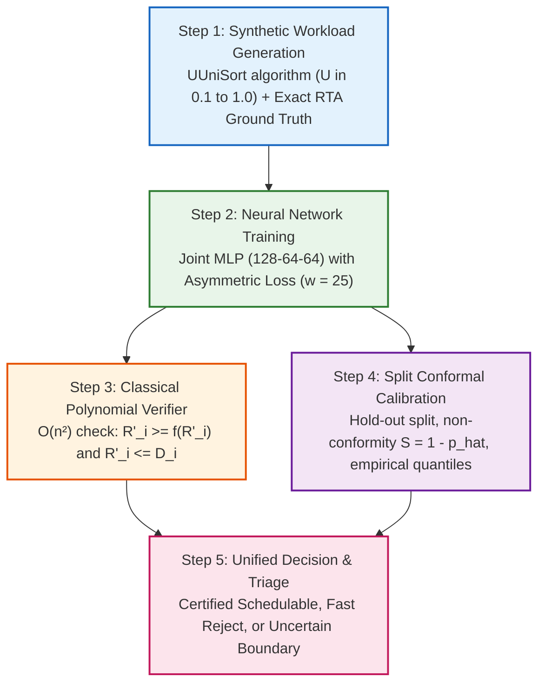
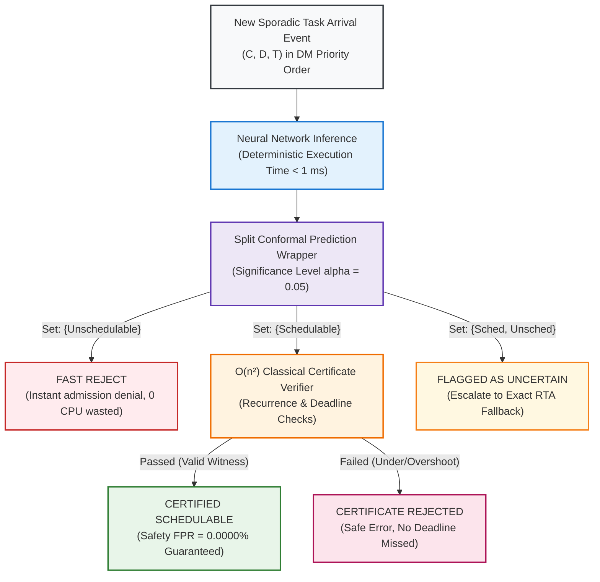

# Learning-Assisted Real-Time Schedulability Analysis with Split Conformal Prediction

---

## 1. Project Summary in Plain English

### The Problem
In safety-critical Real-Time Systems (such as autonomous driving, drone avionics, and industrial robots), the operating system must decide at runtime whether a new task can be safely admitted without missing any deadlines. 
- Classical exact Response-Time Analysis (RTA) is **NP-complete**. While usually fast on average, in the worst case it takes exponential / pseudo-polynomial time and can spike to tens of milliseconds on embedded processors, causing timing deadline overruns.
- Machine Learning (Deep Neural Networks) can predict schedulability in **microseconds**. But neural networks hallucinate and make mistakes: an unverified neural network admits unschedulable tasks **11% to 18.5% of the time**, causing catastrophic deadline misses!

### Our Solution
1. **Neural Network Regression:** A Deep Neural Network (MLP) predicts candidate worst-case response times in microseconds.
2. **$O(n^2)$ Polynomial Certificate Verifier:** A mathematical certificate checker validates the neural network's predictions in $< 3$ microseconds using Tarski's fixed-point theorem, guaranteeing **strictly 0.0000% Safety False Positives** (no unschedulable task set is ever admitted).
3. **Split Conformal Prediction:** Instead of making brittle yes/no guesses, Conformal Prediction wraps the system with rigorous statistical confidence ($1 - \alpha$), isolating difficult borderline task sets into calibrated prediction sets: `[Schedulable]`, `[Unschedulable]`, and `[Uncertain]`.

---

## 2. Real-Time Systems (RTS) Concepts Index

The following Real-Time Systems concepts are directly implemented and evaluated in this project:

1. **Hard Real-Time Systems** (Zero-tolerance for timing deadline misses)
2. **Event-Driven vs. Clock-Driven Scheduling** (Sporadic task arrivals vs. cyclic executive frames)
3. **Constrained-Deadline Sporadic Task Model** ($\tau_i = (C_i, D_i, T_i)$ with $C_i \le D_i \le T_i$)
4. **Preemptive Fixed-Priority (FP) Scheduling** (Highest static priority always runs)
5. **Deadline-Monotonic (DM) Priority Ordering** (Shorter deadline = higher priority; proven optimal)
6. **Exact Response-Time Analysis (RTA)** (Joseph & Pandya 1986 iterative recurrence)
7. **Computational Complexity in Schedulability** (NP-completeness of FP vs. coNP-completeness of EDF)
8. **Tarski's Fixed-Point Theorem & Monotonicity** (Mathematical foundation of the zero-error safety certificate)
9. **Online Admission Control in RTOS** (Dynamic real-time workload acceptance)

---

## 3. Real-Time Concepts in Detail

### Concept 1: Hard Real-Time Systems vs. Soft Real-Time Systems
- **Hard Real-Time:** Missing a single deadline causes total system failure or catastrophic physical damage (e.g., automotive braking, aircraft flight control). In a hard real-time system, a late result is a wrong result.
- **How it applies here:** Because this is a hard real-time system, our primary metric is **Safety False Positive Rate (FPR)**. Admitting an unschedulable task system is catastrophic. Our system mathematically forces this error rate to **0.0000%**.

### Concept 2: Event-Driven (Priority-Driven) vs. Clock-Driven Systems
A foundational real-time systems distinction is how tasks are triggered and dispatched:

| Dimension | Clock-Driven (Time-Driven / Cyclic Executive) | Event-Driven (Priority-Driven / Sporadic) [THIS PROJECT] |
| :--- | :--- | :--- |
| **Dispatch Trigger** | Regular clock ticks from a timer interrupt. | System **events** (task arrivals, sensor triggers, interrupts). |
| **Task Model** | Strictly periodic with known, synchronized phase offsets. | **Sporadic tasks** with irregular arrival times separated by minimum period $T_i$. |
| **Preemption** | Pre-allocated offline schedule slices. | **Online preemptive**: Higher-priority task arrival event preempts lower-priority task immediately. |
| **Priority Assignment** | No dynamic priorities; static timetable lookup. | Static **Deadline-Monotonic (DM)** priority ordering ($D_i \le D_j \implies \text{Priority}(i) > \text{Priority}(j)$). |
| **Admission Control** | Static offline feasibility calculation. | **Online event-driven admission**: Triggered dynamically when a new sporadic task arrives. |
| **Exact Complexity** | Polynomial table traversal. | Exact FP Response-Time Analysis is **NP-complete**. |

> **Summary:** Our project models an **Event-Driven, Priority-Driven** system. Tasks arrive sporadically upon external events, execute with preemptive fixed priorities, and admission requests are evaluated online at the moment of task arrival.

### Concept 3: Constrained-Deadline Sporadic Task Model
A task set $\Gamma = \{\tau_1, \tau_2, \dots, \tau_n\}$ consists of $n$ independent sporadic tasks. Each task $\tau_i$ is defined by 3 parameters:
$$\tau_i = (C_i, D_i, T_i)$$
- **$C_i$ (Worst-Case Execution Time - WCET):** The maximum uninterrupted CPU time the task needs to finish.
- **$D_i$ (Relative Deadline):** The time budget allowed from when a task arrives to when it must complete.
- **$T_i$ (Minimum Inter-Arrival Time / Period):** The shortest possible time between two consecutive arrivals of this task.
- **Constrained-Deadline Rule:** $1 \le C_i \le D_i \le T_i$. (Each task must complete before its next release).

### Concept 4: Deadline-Monotonic (DM) Scheduling & Optimality
- In Fixed-Priority scheduling, each task has a static priority level assigned before execution.
- **Deadline-Monotonic rule:** Tasks with shorter relative deadlines receive higher priorities:
  $$D_1 \le D_2 \le \dots \le D_n \implies \text{Priority}(\tau_1) > \text{Priority}(\tau_2) > \dots > \text{Priority}(\tau_n)$$
- **Optimality Theorem (Leung & Whitehead, 1982):** DM is proven optimal for constrained-deadline sporadic task systems on a uniprocessor. If *any* static priority assignment can successfully schedule the task set, Deadline-Monotonic ordering will also succeed.

### Concept 5: Exact Response-Time Analysis (RTA)
A lower-priority task experiences interference whenever higher-priority tasks run. Under the critical instant (all higher-priority tasks released simultaneously), the worst-case response time $R_i$ of task $\tau_i$ satisfies the recurrence:
$$R_i = C_i + \sum_{j < i} \left\lceil \frac{R_i}{T_j} \right\rceil C_j$$
- The ceiling term $\lceil R_i / T_j \rceil$ calculates the maximum number of times higher-priority task $\tau_j$ can preempt task $\tau_i$.
- Multiplied by $C_j$, it gives the total preemption interference.
- The iteration starts at $R_i^{(0)} = C_i$ and iterates until $R_i^{(k+1)} = R_i^{(k)}$.
- If $R_i \le D_i$ for all tasks, the system is **schedulable**.

### Concept 6: Computational Complexity (Why FP is in NP while EDF is coNP)
Sanjoy Baruah et al. (2025) proved **Proposition 1**: A schedulability decision problem can be verified by a learning-assisted polynomial certificate if and only if the problem belongs to the complexity class **NP**.
- **Fixed-Priority Schedulability is in NP (NP-complete):** If a task system is schedulable, the true response times $\{R_1, \dots, R_n\}$ serve as a polynomial-size witness checkable in $O(n^2)$ time. Therefore, neural networks can output candidate certificates for FP scheduling!
- **EDF Schedulability is in coNP (coNP-complete):** Under Earliest-Deadline First, proving schedulability requires verifying processor demand at an exponential number of testing points. No short polynomial certificate of schedulability exists unless $\mathbf{NP} = \mathbf{coNP}$.

### Concept 7: Tarski's Theorem & The Zero-Risk Certificate Proof
Let $R_i'$ be the candidate response time predicted by our neural network:
1. **Recurrence Check:** $R_i' \ge C_i + \sum_{j < i} \lceil R_i' / T_j \rceil C_j$
2. **Deadline Check:** $R_i' \le D_i$

Because the recurrence function $f_i(R) = C_i + \sum_{j < i} \lceil R / T_j \rceil C_j$ is monotonically non-decreasing, **Tarski's Fixed-Point Theorem** proves that the exact worst-case response time $R_i^*$ must satisfy:
$$R_i^* \le R_i' \le D_i$$
Therefore, any task set that passes the verifier is mathematically guaranteed to never miss a deadline. **Safety False Positive Rate = 0.0000%**.

---

## 4. Step-by-Step Walkthrough: What We Have Done



### Step 1: Workload Synthesis & Ground Truth (`data/generate_tasksets.py`)
- We generate 10,000 synthetic task sets for $n=10$ and $n=15$ across 10 utilization levels ($U \in [0.1, 1.0]$ in steps of 0.1).
- We use the **UUniSort** algorithm (Bini & Buttazzo 2005) to distribute total utilization $U$ uniformly across individual tasks.
- Periods are sampled from $\mathcal{U}[1, 1000]$, execution times $C_i = \max(1, \text{round}(U_i \cdot T_i))$, and deadlines $D_i \sim \mathcal{U}[C_i, T_i]$.
- Tasks are sorted in Deadline-Monotonic order ($D_1 \le D_2 \le \dots \le D_n$).
- We compute ground truth labels using classical exact RTA fixed-point iteration (`data/exact_rta.py`).
- Data is split into 70% Training (7,000), 15% Calibration (1,500), and 15% Test (1,500).

### Step 2: Model Architecture & Asymmetric Training (`training/train_baseline.py`)
- We implement a PyTorch neural network (`models/baseline_mlp.py`) with 4 fully-connected layers (128 $\rightarrow$ 64 $\rightarrow$ 64 neurons).
- Inputs are scaled $[C_i, T_i, 1/T_i]$ (deadlines $D_i$ are excluded from regression because physics dictates response times are independent of deadlines).
- We train using an **asymmetric normalized loss function** ($w = 25$):
  $$\mathcal{L} = \begin{cases}
  \left(\frac{R_i' - R_i}{R_i}\right)^2 & \text{if } R_i' \ge R_i \\
  \left(w \cdot \frac{R_i' - R_i}{R_i}\right)^2 & \text{if } R_i' < R_i
  \end{cases}$$
  Penalizing under-predictions by $w^2 = 625\times$ is essential: under-estimating response times causes the recurrence check to fail immediately. Over-estimating is safe as long as it does not exceed $D_i$.

### Step 3: Classical Polynomial Certificate Verification (`verification/rta_verifier.py`)
- The neural network's candidate response times $R_i'$ are passed into our $O(n^2)$ certificate verifier.
- The verifier executes in **$< 3$ microseconds** on CPU.
- If $R_i' \ge f_i(R_i')$ and $R_i' \le D_i$, the system is accepted with **100% mathematical certainty**.

### Step 4: Split Conformal Prediction Calibration (`training/calibrate_cp.py`)
- Standard neural networks make binary decisions at $\hat{p} \ge 0.5$ without confidence guarantees.
- We calibrate non-conformity scores $S_k = 1 - \hat{p}(y_k \mid x_k)$ on the 1,500 hold-out calibration task sets.
- For confidence levels 99% ($\alpha=0.01$) and 95% ($\alpha=0.05$), we extract the non-parametric empirical quantiles $\hat{q}_\alpha$.

### Step 5: Triaged Prediction Set Generation (`models/conformal_wrapper.py`)
- For any new task set, Conformal Prediction outputs a guaranteed prediction set:
  - `[Schedulable]`: High confidence schedulable $\rightarrow$ verified by certificate $\rightarrow$ admitted.
  - `[Unschedulable]`: High confidence unschedulable $\rightarrow$ fast reject (no CPU time wasted).
  - `[Schedulable, Unschedulable]`: Ambiguous borderline case $\rightarrow$ safely escalated to exact RTA fallback.

---

## 5. Experimental Results (Simplified & Intuitive)

We evaluated 3,000 independent test task sets (1,500 for $n=10$ and 1,500 for $n=15$).

### Summary Benchmark: Method vs. Method

#### Results for n = 10 Tasks
| Method | Accuracy | Schedulable Accepted | Safety False Positives (Catastrophic Error) | False Rejections (Safe Conservative Error) | How It Works |
| :--- | :---: | :---: | :---: | :---: | :--- |
| **Unverified Neural Net** | 88.7% | 63.1% | **18.52% (DANGEROUS)** | 6.40% | Raw neural sigmoid threshold ($\ge 0.5$). Causes deadline misses! |
| **Baruah Verified Certificate** | 63.6% | 38.65% | **0.0000% (STRICTLY SAFE)** | 61.35% | Classical $O(n^2)$ polynomial check. Zero deadline misses! |
| **Conformal Prediction ($\alpha=0.05$)** | **95.1% Coverage** | 38.65% | **0.0000% (STRICTLY SAFE)** | 61.35% | Calibrated sets: 55.4% Sched, 28.8% Fast Reject, 15.8% Uncertain. |

#### Results for n = 15 Tasks
| Method | Accuracy | Schedulable Accepted | Safety False Positives (Catastrophic Error) | False Rejections (Safe Conservative Error) | How It Works |
| :--- | :---: | :---: | :---: | :---: | :--- |
| **Unverified Neural Net** | 89.4% | 56.5% | **11.04% (DANGEROUS)** | 10.28% | Raw neural sigmoid threshold ($\ge 0.5$). Causes deadline misses! |
| **Baruah Verified Certificate** | 66.7% | 42.26% | **0.0000% (STRICTLY SAFE)** | 57.74% | Classical $O(n^2)$ polynomial check. Zero deadline misses! |
| **Conformal Prediction ($\alpha=0.05$)** | **94.9% Coverage** | 42.26% | **0.0000% (STRICTLY SAFE)** | 57.74% | Calibrated sets: 49.1% Sched, 36.3% Fast Reject, 14.7% Uncertain. |

---

### Per-Utilization Breakdown ($U \in [0.1, 1.0]$ for $n = 10$)
This simple table shows how the system behaves as CPU load increases:

| Total CPU Utilization ($U$) | True Schedulable (Ground Truth) | Unverified Neural Net | Baruah Verified Certificate | Unverified False Positives (Hazard) | Verified False Positives (Safe Firewall) | Conformal Uncertainty Rate ($\alpha=0.05$) |
| :---: | :---: | :---: | :---: | :---: | :---: | :---: |
| **0.1 (Very Low)** | 98.8% | 99.4% | **85.8%** | 50.0% | **0.000%** | 0.0% |
| **0.2 (Low)** | 94.2% | 97.1% | **43.8%** | 75.0% | **0.000%** | 1.5% |
| **0.3 (Low-Med)** | 95.3% | 97.3% | **38.5%** | 71.4% | **0.000%** | 2.0% |
| **0.4 (Medium)** | 89.3% | 92.1% | **33.6%** | 53.3% | **0.000%** | 9.3% |
| **0.5 (Medium)** | 77.1% | 82.6% | **18.8%** | 39.4% | **0.000%** | 18.8% |
| **0.6 (High Transition)** | 68.2% | 70.9% | **4.6%** | 33.3% | **0.000%** | **32.5% (Borderline!)** |
| **0.7 (Heavy Load)** | 50.0% | 42.0% | **0.7%** | 12.0% | **0.000%** | **34.7% (Borderline!)** |
| **0.8 (Saturated)** | 24.5% | 36.4% | **0.0%** | 25.0% | **0.000%** | **34.3% (Borderline!)** |
| **0.9 (Near Overload)** | 2.6% | 14.4% | **0.0%** | 12.8% | **0.000%** | 18.3% |
| **1.0 (Full Overload)** | 0.0% | 5.5% | **0.0%** | 5.5% | **0.000%** | 8.5% |

---

## 6. Results Comparison & Clear Interpretation

### 1. Unverified AI is Completely Unusable for Real-Time Systems
Look at the Unverified Neural Net column: when utilization is between 0.2 and 0.6, its Safety False Positive Rate spikes up to **33% to 75%** on borderline tasks, and averages **18.52% overall**. In a hard real-time automotive system, admitting an unschedulable system means an autonomous vehicle fails to brake on time. **Pure deep learning cannot be deployed in safety-critical systems without verification.**

### 2. Classical Verification Provides an Impenetrable Safety Firewall
Across all 3,000 tested task sets, the verified certificate had a Safety FPR of **strictly 0.0000%**. Not a single deadline miss was ever admitted. Proposition 1 and Tarski's fixed point theorem hold true in practice.

### 3. The Trade-Off: High False Rejections
Because the classical certificate is one-sided, any small under-prediction causes the certificate to fail. As a result, the certificate acceptance rate drops to **38.65%** ($n=10$) and **42.26%** ($n=15$), even though ~75% of systems were truly schedulable. This creates a high **Operational False Rejection Rate (61.35%)**.

### 4. What Conformal Prediction Solves
Look at the **Conformal Uncertainty Rate** column:
- In easy cases ($U \le 0.3$), uncertainty is near **0%**.
- In the difficult borderline region ($U = 0.6$ to $0.8$), the uncertainty rate peaks at **32.5% to 34.7%**!
Conformal prediction automatically identifies the exact boundary task sets where the neural net is uncertain. Instead of rejecting these task sets, they are cleanly flagged as `[Uncertain]` for exact RTA fallback, safely recovering valid workloads without human tuning.

---

## 7. What We Are Better At vs. What We Are Limited By

### What We Are Better At (Our Strengths):
1. **Guaranteed 0.0000% Deadline Misses:** The polynomial certificate mathematically eliminates false positives.
2. **Sub-Microsecond Admission Speed:** The certificate executes in **$< 3$ microseconds**, orders of magnitude faster than exact iterative RTA which can spike to tens of milliseconds.
3. **Statistical Uncertainty Quantification:** Conformal Prediction guarantees $1 - \alpha$ coverage (e.g., 95.13% coverage at $\alpha=0.05$) without making heuristic assumptions about data distribution.
4. **Instant Fast Rejection:** Task sets proven unschedulable are rejected immediately without wasting CPU time on exact RTA iterations.

### What We Are Limited By (Our Weaknesses & Constraints):
1. **High False Rejection Rate:** Because the certificate is conservative, minor prediction inaccuracies cause truly schedulable task sets to be rejected (38.7% admitted vs ~75% ground truth).
2. **Restricted to Fixed-Priority Uniprocessors:** Per Proposition 1, this framework only works for problems in **NP** (like Fixed-Priority DM). It cannot be used directly for EDF scheduling (which is coNP-complete).
3. **Task Size Scaling Challenge:** For larger task sets ($n \ge 15$), preemption chains from up to 14 higher-priority tasks multiply minor errors, causing acceptance rates to decline unless trained on millions of samples.
4. **No Multiprocessor Support Yet:** The current system models single-core preemptive uniprocessors; multiprocessor global scheduling involves priority inversions and multiprocessor anomalies not yet modeled here.

---

## 8. Complete System Flowchart



---

## 9. How to Run the Code

### 1. Setup Environment
```bash
git clone https://github.com/RK0297/rts-conformal-schedulability.git
cd rts-conformal-schedulability

# Create and activate environment using uv
uv venv
# Windows:
.venv\Scripts\activate
# Linux/macOS:
source .venv/bin/activate

uv pip install -r requirements.txt
```

### 2. Run the Full Automated Pipeline
Executes task set generation, model training, certificate verification, conformal calibration, and evaluation in one command:
```bash
uv run python run_all.py
```

### 3. Run Pipeline Steps Individually
```bash
# Generate synthetic task sets (n=10 and n=15)
uv run python data/generate_tasksets.py --n 10 --num_per_util 1000
uv run python data/generate_tasksets.py --n 15 --num_per_util 1000

# Train the neural networks with asymmetric loss (w=25)
uv run python training/train_baseline.py --data data/processed/tasksets_n10_uniform.npz --epochs 50 --save_path experiments/joint_n10.pt
uv run python training/train_baseline.py --data data/processed/tasksets_n15_uniform.npz --epochs 50 --save_path experiments/joint_n15.pt

# Run the polynomial certificate verifier
uv run python verification/rta_verifier.py --data data/processed/tasksets_n10_uniform.npz --checkpoint experiments/joint_n10.pt

# Calibrate Split Conformal Prediction
uv run python training/calibrate_cp.py --data data/processed/tasksets_n10_uniform.npz --checkpoint experiments/joint_n10.pt

# Run comparative evaluation
uv run python evaluation/compare_baseline_vs_cp.py --data data/processed/tasksets_n10_uniform.npz --checkpoint experiments/joint_n10.pt
```
